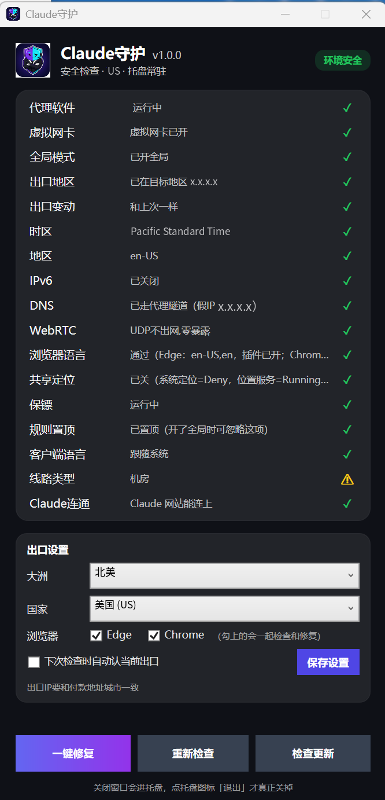

# Claude守护

**用 Claude 之前，先帮你把电脑的网络和隐私检查一遍；不安全就自动关掉 Claude 和浏览器。**

**适用：用 Claude 怕账号风控时，先做护号／防封检查（出口 IP、DNS、全局代理、定位、WebRTC）。**

**简体中文** | [English](README.en.md)

[⬇️ 下载最新版](https://github.com/mfksffitx-xi2/ClaudeGuard/releases/latest) · [📖 使用说明](使用说明.txt) · [❓ 常见问题](#-常见问题)

---

## 📸 界面预览

全部打勾、右上角显示「环境安全」，就可以放心用 Claude。

## ✨ 功能特点

- **一键体检**：17 项检查一屏看完，绿勾 = 没问题，红叉 = 要处理，黄色感叹号 = 只是提醒
- **自动保镖**：守护开着时，如果出口国家不对、代理没开好、定位开着，会自动关掉 Claude 和浏览器，防止露出真实地址
- **不误关**：只出一次问题不会动手，要连续几次都不对、持续 20 秒左右才会关；单纯网站打不开不会关浏览器
- **一键修复**：时区、地区格式、IPv6、共享定位、浏览器防泄露、网页语言等，能自动改的一键改好
- **选国家**：先选大洲再选国家，也可以让它按你现在的出口自动认
- **托盘常驻**：关掉窗口只是缩到右下角，继续在后台守护
- **检查更新**：一点就知道有没有新版本，有就打开下载页，你自己下载
- **配套浏览器插件**：把浏览器的地区和字体特征改成英文环境（Edge / Chrome 都能装）

## 💻 需要什么

| 项目 | 要求 |
| --- | --- |
| 系统 | Windows 10 或 Windows 11 |
| 代理软件 | [Clash Verge Rev](https://github.com/clash-verge-rev/clash-verge-rev)（或兼容的 Clash 客户端），并且有能用的节点 |
| 浏览器 | Edge 或 Chrome（用来装配套插件） |
| 管理员权限 | 安装不需要；一键修复时部分项目会弹窗问「是否允许更改」，点「是」 |

## ⬇️ 下载与安装

👉 **[点这里打开最新版下载页](https://github.com/mfksffitx-xi2/ClaudeGuard/releases/latest)**

| 文件 | 说明 |
| --- | --- |
| `ClaudeGuard-v版本号.zip` | ✅ **下这个**，就是安装包 |
| Source code (zip / tar.gz) | GitHub 自动附带的源码，普通用户不用下 |

安装步骤（只做一次）：

1. 下载 `ClaudeGuard-v版本号.zip`
2. **先把整个压缩包解压出来**（不要在压缩包里直接双击）
3. 双击 `安装.bat`，按屏幕提示走完
4. 桌面会多一个「Claude守护」图标

> 不需要管理员，不会开机自启。以后装新版也是同样双击 `安装.bat`，原来的设置不会丢。
>
> 卸载：双击 `卸载.bat`，删资料前会先问你。

### 装浏览器插件（每个浏览器装一次，可选但建议）

1. Edge 地址栏输入 `edge://extensions` 回车（Chrome 输入 `chrome://extensions`）
2. 打开页面上的「开发人员模式」（Chrome 叫「开发者模式」）
3. 点「加载解压缩的扩展」（Chrome 叫「加载已解压的扩展程序」）
4. 选这个文件夹：`%USERPROFILE%\.claude-switcher\extension\yingwen-quyu-ziti`

> 装好后不要移动或删除这个文件夹。Edge 弹出「关闭开发人员模式扩展」时，点「保留」，不要点「关闭」。

## 🚀 使用方法

1. **先在 Clash 里点好三样**：打开「虚拟网卡（TUN）」、模式选「全局」、选一个目标国家的节点
2. 双击桌面「Claude守护」
3. 第一次用：在「出口设置」里选好 **大洲** 和 **国家**（要和 Clash 节点的国家一样），勾上你用的浏览器，点「保存设置」
4. 看检查列表：全部绿勾、显示「环境安全」→ 可以用 Claude
5. 有红叉 → 点「一键修复」，修完点「重新检查」
6. 用 Claude 时**一直开着它**（关窗口只是进托盘）；真要退出：托盘图标右键 →「退出」

> ⚠️ **出口 IP 要和付款地址城市一致。**

## 📋 检查项说明

| 检查项 | 看的是什么 | 不通过怎么办 |
| --- | --- | --- |
| 代理软件 | Clash 有没有在运行 | 打开 Clash |
| 虚拟网卡 | Clash 的虚拟网卡（TUN）开了没 | 在 Clash 里打开「虚拟网卡」 |
| 全局模式 | Clash 是不是「全局」模式 | 在 Clash 里选「全局」 |
| 出口地区 | 你现在上网显示在哪个国家 | 在 Clash 换成目标国家的节点 |
| 出口变动 | 出口地址和上次比有没有变 | 一般是提醒，换了节点会变 |
| 时区 | 电脑时区是不是目标国家的 | 一键修复 |
| 地区 | 电脑地区格式是不是 en-US | 一键修复 |
| IPv6 | IPv6 关了没（开着可能绕过代理） | 一键修复 |
| DNS | 查网址有没有走代理（没走就是红的） | 一键修复，或检查 Clash 设置 |
| WebRTC | 浏览器会不会偷偷露出真实地址 | 一键修复 |
| 浏览器语言 | 网页首选语言是不是英文、插件装了没 | 一键修复（先关掉那个浏览器）+ 装插件 |
| 共享定位 | 电脑和浏览器的定位关了没 | 一键修复 |
| 保镖 | 自动保护有没有在运行 | 开着守护窗口就会运行 |
| 规则置顶 | Claude 相关规则在 Clash 里排没排最前 | 开了全局时可以不管 |
| 客户端语言 | Claude 客户端语言 | 跟随系统，一般不用管 |
| 线路类型 | 节点是住宅还是机房 | 黄色只是提醒；换住宅节点会变绿 |
| Claude连通 | Claude 网站能不能连上 | 先把上面的代理、全局、出口弄好 |

## 🔧 「一键修复」会改什么

**会自动改：**

- 电脑时区 → 目标国家的时区
- 电脑地区格式 → en-US
- 关掉 IPv6
- 关掉系统共享定位，并禁止勾选的浏览器被网站要位置
- 给勾选的浏览器加 WebRTC 防泄露设置
- 勾选的浏览器网页首选语言改成英文（浏览器界面语言不变；要先关掉那个浏览器）
- 加一条防火墙规则，挡住 WebRTC 用的 UDP 端口
- 打开 Clash 的 DNS 防泄露设置

**不会自动改（要你自己在 Clash 里点）：** 虚拟网卡、全局模式、选节点。浏览器插件也要自己装。

## ❓ 常见问题

<b>浏览器突然被关掉了？</b>

这是「保镖」在保护你：它发现出口国家不对、代理没开好或者定位开着，会关掉 Claude 和浏览器。打开 Claude守护 看哪一项是红的，修好后再开浏览器。v1.0.0 起，只出一次问题不会关，要连续几次都不对才会动手。

<b>「线路类型」一直是黄色的？</b>

说明你的节点是机房 IP。这只是提醒，不影响使用；换成住宅 IP 的节点就会变绿。

<b>一键修复时弹出「是否允许更改」？</b>

有些项目（比如定位、防火墙）要管理员才能改，点「是」就行。

<b>「浏览器语言」修不好？</b>

改浏览器语言前要先把那个浏览器完全关掉（包括右下角托盘里的），再点一键修复。

<b>点了窗口右上角的叉，程序没退出？</b>

正常。它缩到右下角托盘继续守护。要真正退出：托盘图标右键 →「退出」。

<b>点「检查更新」提示已经是最新版？</b>

说明你装的就是最新版。有新版本时，它会直接打开下载页。

<b>怎么卸载？</b>

双击 `卸载.bat`。删账号资料之前会先问你。

## 📜 许可与免责声明

本项目使用 **非商业许可**，详见 [LICENSE](LICENSE)。

- ✅ 可以：个人使用、学习、修改、免费分享
- ❌ 禁止：出售、收费授权、捆绑进商业产品或服务
- 商业使用要先取得作者书面同意

> **免责声明**：本工具只帮你减少常见的设置错误和泄露风险，**不保证匿名，也不保证账号安全**。请遵守你所在地区的法律和相关服务的使用条款，使用后果由使用者自己负责。本项目是个人非商业作品，与 Anthropic 没有任何关系。
